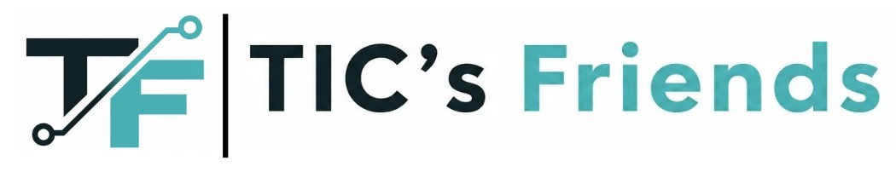

# Datathon FME 2026

  

## Introduction

Hi, we are Marc Bosch Manzano, Blanca Garcia Rodríguez, Darcy Thomas Robertson, and Shuangjie Xia, four engineering students from Universitat Pompeu Fabra. Our group is called TIC's Friends, and we are going to participate to the Datathon FME 2026.

## Challenges

Reptes principals (Qualcomm, Tiny Bird, UPC Sostenible) vs Side Challenges 

### Main Challenges

1. Qualcomm:

Semiconductor company, comunications company, chips for PCs, phones, IOT, etc. Molt interessant i innovador, els professors no tenen suficients recursos, IA educativa per mentoritzar i aprendre conceptes matemàtics. Repte: fer servir arduino amb Linux Debian per executar IA, Edge AI, sense que les peticions vagin a l'altre punta del món. Crear un mentor de matemàtiques dintre de l'Arduino . També disposarem del model m3-cam de problemes de proves Cangur per entrenar un petit model d'intel·ligència articficial generativa per a resoldre problemes matemàtics. Executar xarxes neuronals dins de l'Arduino, aprendre com funcionen els LLMs. Tenim un GitHub amb documentació. Penjar-ho a l'Arduino Project HUB i repositori GitHub. Explicar i documentar bé el projecte.

-- > problemes trigaríem molt pq s'han de descarregar moltes coses

2. TinyBird

Real-time analytics. Processar dades dels clients, proveïdor d'infraestructura. RawTree (ingest-first process-later), dynamic-schema, optimized LLM, C++ codi, predictable. Generar índexs per les consultes per accelerar-les. ClickHouse. Algorisme de resposta de request. Expected purchases per 100 requests. Oracle: the best list possible, recuperació d'informació. Agent: it decides what to ingest, which questions to ask and what to do with the answers, through the CLI, APL, SDK or MCP.

--> problema, connexió a internet (failed packets)
--> ens han donat un livestream
--> hem de mostrar quins productes volen mostrar
--> maximitzar vendes
--> maximitzar revenue (vendes de valor alt)
--> full chat
--> demostrar el que has après

3. UPC Sostenible

Go to this project [README.md](/upc-sostenible/README.md)

Carregar bateria, descarregar bateria, en repòs. 
Dades:
- Demanda del Campus
- Generació solar fotovolaica
- Bateria industrial
- Preu de la llum actual
Feina:
- per cada hora del dia, decidir què fer amb la bateria
- què coneixem: context temporal, har, ...
Valoració: score = 0,7 * CO2 + 0,3 * Cost - Penalitzacions
Starter kit: dades reals
LLiurament i validació: 
- 1. test local a consola
- 2. validació ràpida web
- 3. tramesa oficial al leaderboard
- 4. submizzion.zip

### Side Challenge 

John W. Tukey (1915-2000)
- Estadística per comprendre les dades, millora de l'anàlisi exploratòria de dades, creador d'eines descriptives (boxplot), fast fourier transform.
- Dashboard: seleccionar informació rellevant i mostrar quins conclusions aporta. Shiny, Tableau, aplicació web, 
- Side challenge de visualització de dades

## Bibliography
[horari-datathon-fme.pdf](documents/horari-datathon-fme.pdf) 
https://www.datathon.cat/ 
https://github.com/todo-md/todo-md 

