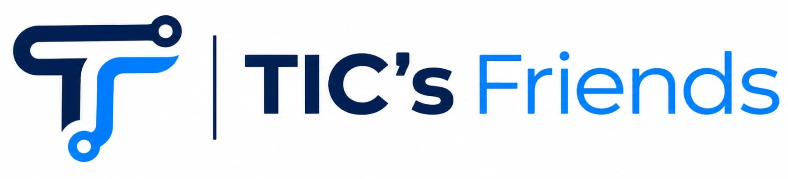

# Datathon FME 2026

  

## Introduction

Hi, we are Marc Bosch Manzano, Blanca Garcia Rodríguez, Darcy Thomas Robertson, and Shuangjie Xia, four engineering students from Universitat Pompeu Fabra. Our group is called TIC's Friends, and we are going to participate to the Datathon FME 2026.

## Bibliography
[horari-datathon-fme.pdf](documents/horari-datathon-fme.pdf) 
https://www.datathon.cat/ 
https://github.com/todo-md/todo-md 

